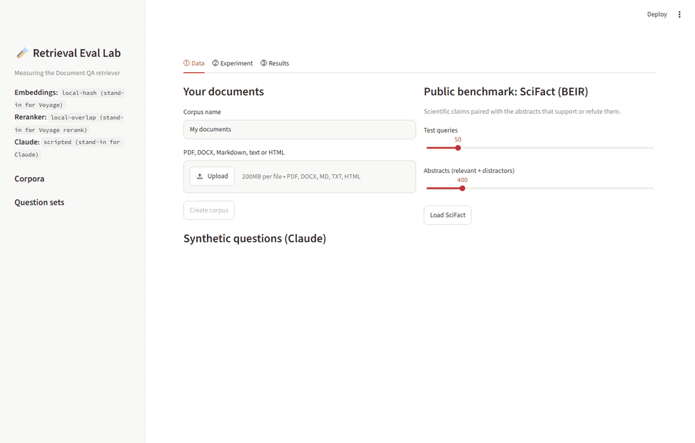
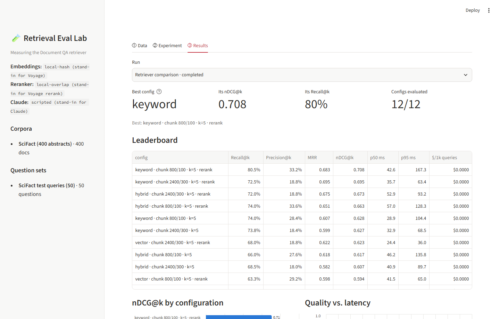
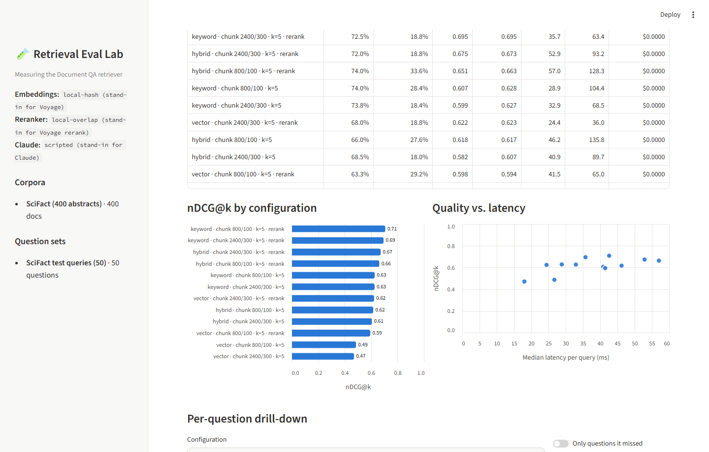
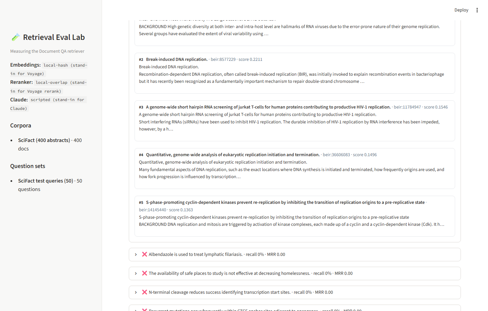
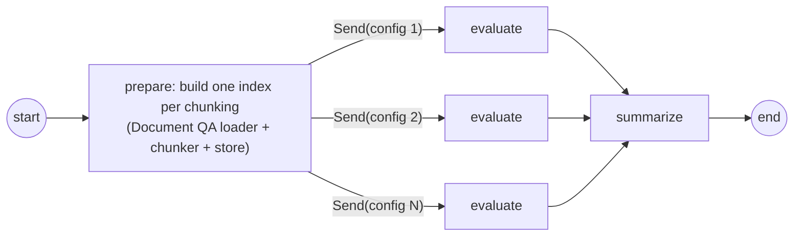

# Retrieval Evaluation Lab

[](https://github.com/yordanossimegnew/retrieval-eval-lab/actions/workflows/tests.yml)  [](LICENSE)

Measure and tune the retriever of
[Document QA with Citations](https://github.com/yordanossimegnew/document-qa-citations) instead
of guessing. Build a question set (synthetic from your own documents, or the public **SciFact**
benchmark), then compare retrieval setups side by side:

- vector, keyword and hybrid search,
- chunk sizes,
- reranking,
- query rewriting,

scored with **Recall@k, Precision@k, MRR, nDCG@k, latency and cost**.

Built with **LangGraph** (parallel `Send` fan-out over configurations, Postgres checkpointer) and
**LangChain** (Voyage embeddings and rerank, Claude for question writing and query rewriting),
on **PostgreSQL + pgvector**, with a **FastAPI** API and a **Streamlit** UI.



<sub>The demo runs the real SciFact benchmark (400 abstracts, 50 test queries) through Document QA's real retrieval code on PostgreSQL, with local stand-ins for Voyage embeddings and reranking (named as such in the sidebar). The keyword numbers are real; vector scores reflect the stand-in embedder, not Voyage.</sub>

| Leaderboard | nDCG and quality-vs-latency | Per-question drill-down |
|---|---|---|
|  |  |  |

## Engineering highlights

- Evaluates the *real* retriever of Document QA (its loader, chunker and store), not a re-implementation.
- Each retrieval configuration is a parallel LangGraph `Send` branch. The configurations are vector, keyword or hybrid search, chunk size, reranking, and query rewriting (HyDE).
- Standard IR metrics (Recall@k, Precision@k, MRR, nDCG@k) plus latency and cost, on synthetic questions or the public SciFact benchmark.
- Per-question drill-down shows exactly which documents each configuration found or missed.

## Features

- **Evaluates the real thing:** the lab imports Document QA's own loaders, chunker,
  pgvector `DocumentStore` and hybrid SQL from the sibling repository. It loads them as a
  separate package, `docqa`, so there's no copy and no drift.
- **Two sources of questions:**
  - **Synthetic:** Claude reads sampled passages and writes realistic questions, each with an
    exact evidence quote. Code then **verifies every quote exists in the passage** and drops
    vague, duplicate and copy-paste questions, reporting how many it dropped and why.
  - **SciFact (BEIR):** 300 expert test claims with labelled relevant abstracts, downloaded
    from Hugging Face and cached. You choose how many queries and distractor abstracts to use.
- **Fair across chunk sizes:** ground truth is "this document and this evidence text", not a
  chunk ID, so the same questions score every chunking. A chunk counts as relevant if it
  contains the evidence, and each evidence passage counts once.
- **Configurations compared:**
  - **retriever:** vector, keyword or hybrid
  - **chunk size and overlap**
  - **top-k**
  - **reranking:** retrieve 30 candidates, keep the top k after Voyage `rerank-2.5`
  - **query transform:** none, Claude *rewrite*, or *HyDE*

  The lab builds the grid for you.
- **Metrics:** Recall@k, Precision@k, MRR, nDCG@k (binary gains), hit rate, p50/p95 latency per
  query, and cost (Claude tokens exact; Voyage tokens estimated, priced from your plan). It also
  reports the one-off cost of building each index.
- **Efficient runs:**
  - Each chunking is indexed **once**, in its own Postgres schema with Document QA's tables
    (HNSW + GIN indexes), and reused across configurations and runs.
  - Configurations run **in parallel**.
  - Each query rewrite is computed **once per question** and shared by every configuration
    that uses it.
- **Results you can dig into:**
  - a leaderboard,
  - an nDCG bar chart,
  - a quality-vs-latency scatter,
  - a per-question drill-down with relevant chunks highlighted and an "only misses" filter,
  - a side-by-side comparison of two configurations (`/runs/{id}/compare`).

## Project structure

```
retrieval-eval-lab/
├── README.md
├── requirements.txt
├── .env.example            # copy to .env (never commit .env)
├── .gitignore
├── Dockerfile              # build from the parent folder (includes document-qa-citations)
├── docker-compose.yml      # pgvector Postgres + API + UI
├── main.py                 # FastAPI app (`main:app`)
├── ui/
│   └── app.py              # Streamlit: data, experiment builder, results + charts + drill-down
├── docs/                   # demo.gif + screenshots
├── src/
│   ├── agent/
│   │   ├── agent.py        # LangGraph: question generation + parallel evaluation graphs
│   │   └── memory.py       # Postgres checkpointer
│   ├── evals/
│   │   ├── metrics.py      # relevance matching, Recall/Precision/MRR/nDCG, percentiles
│   │   ├── configs.py      # RetrievalConfig + grid builder
│   │   └── datasets.py     # file corpora, SciFact loader, synthetic question validation
│   ├── tools/
│   │   ├── docqa.py        # imports Document QA's code as `docqa`
│   │   ├── indexes.py      # one Document QA index per chunking, in its own schema
│   │   ├── retrievers.py   # vector / keyword / hybrid (hybrid = Document QA's own search)
│   │   └── labdb.py        # lab tables: corpora, questions, runs, per-query results
│   ├── models/
│   │   └── llm_client.py   # VoyageAIEmbeddings, VoyageAIRerank, ChatAnthropic + token usage
│   ├── prompts/            # question writing, query rewrite, HyDE
│   ├── utils/              # config (env/.env), logging
│   └── api/                # FastAPI routes + schemas
├── tests/                  # metrics, SciFact loader (mocked hub), generation, 24-config run, API
└── data/                   # benchmark downloads are cached in data/benchmarks/ (gitignored)
```

## Setup

Clone this repo **next to** `document-qa-citations` (or set `DOCQA_PATH`):

```bash
git clone https://github.com/yordanossimegnew/document-qa-citations
git clone https://github.com/yordanossimegnew/retrieval-eval-lab
cd retrieval-eval-lab
python -m venv .venv
# Windows: .venv\Scripts\activate   |   macOS/Linux: source .venv/bin/activate
pip install -r requirements.txt
cp .env.example .env              # ANTHROPIC_API_KEY, VOYAGE_API_KEY, DATABASE_URL, TEST_DATABASE_URL
```

```sql
CREATE DATABASE retrieval_lab;
CREATE DATABASE retrieval_lab_test;   -- used only by pytest
\c retrieval_lab
CREATE EXTENSION vector;              -- and the same in retrieval_lab_test
```

## Run it

```bash
uvicorn main:app --reload         # API  -> http://localhost:8000/docs
streamlit run ui/app.py           # UI   -> http://localhost:8501
```

1. **Data:** upload your documents (then *Generate questions*), or *Load SciFact*.
2. **Experiment:** pick retrievers, chunk sizes, top-k, reranking and query transforms, then
   start the run.
3. **Results:** read the leaderboard, check the charts, then drill into the questions a setup
   missed.

## API

| Method | Path                          | Description                                                  |
|--------|-------------------------------|--------------------------------------------------------------|
| POST   | `/corpora`                    | Upload files (multipart, `name` + `files`)                   |
| POST   | `/corpora/benchmark`          | `{"max_queries": 100, "max_docs": 800}`: load SciFact        |
| POST   | `/question-sets/synthetic`    | `{"corpus_id", "passages": 30, "per_passage": 2}` (background) |
| GET    | `/question-sets/{id}`         | Questions with their relevant documents and evidence         |
| POST   | `/runs`                       | `{"question_set_id", "grid": {...}}` (background)            |
| GET    | `/runs/{id}`                  | Progress and results, best configuration first               |
| GET    | `/runs/{id}/queries`          | Per-question results for one config (`only_misses=true`)     |
| GET    | `/runs/{id}/compare?a=&b=`    | Questions one config finds that the other misses             |

```json
POST /runs
{"question_set_id": "24e1…", "grid": {"retrievers": ["vector", "keyword", "hybrid"],
 "chunk_sizes": [[800, 100], [2400, 300]], "top_k": [5], "rerank": [false, true],
 "query_transforms": ["none", "hyde"]}}
```

## Tests

```bash
pytest -q        # needs TEST_DATABASE_URL and document-qa-citations next to this repo
```

The tests cover:
- the metrics, against hand-computed values;
- the SciFact loader, against a mocked Hugging Face;
- the synthetic-question filter;
- a full run of **24 configurations in parallel** through Document QA's real code on
  pgvector, checking that each chunking is indexed once and each query rewritten once;
- the HTTP API end to end.

## Configuration

| Variable                        | Default             | Meaning                                         |
|---------------------------------|---------------------|-------------------------------------------------|
| `DOCQA_PATH`                    | `../document-qa-citations` | The project under evaluation             |
| `DATABASE_URL`                  | *(required)*        | PostgreSQL with pgvector                        |
| `VOYAGE_MODEL` / `EMBEDDING_DIM`| `voyage-3.5` / 1024 | Embeddings (match Document QA's)                |
| `VOYAGE_RERANK_MODEL`           | `rerank-2.5`        | Reranker                                        |
| `AGENT_MODEL`                   | `claude-opus-5-5`   | Question writing and query rewriting            |
| `VOYAGE_*_PRICE_PER_MTOK`       | `0`                 | Your Voyage prices, for the cost column         |

## How a run works



For every question, `evaluate` does the following:
1. Optionally transforms the query.
2. Embeds it.
3. Retrieves with the configured retriever (hybrid is `DocumentStore.hybrid_search` itself).
4. Optionally reranks.
5. Scores the top k against the ground truth, timing every step.

It then saves per-question results and aggregates them. All state lives in Postgres, so runs
can be inspected and compared later.

## Ideas to extend

- LLM-judged relevance to catch good chunks the labels missed.
- More BEIR datasets (FiQA, NFCorpus) and significance tests between configurations.
- Track a "regression budget": fail CI if a retriever change lowers nDCG on the fixed set.
